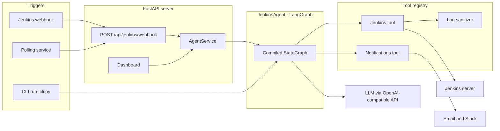
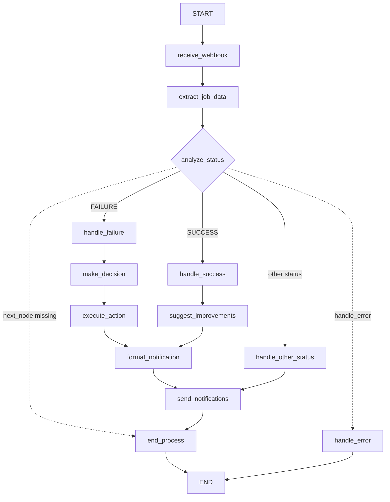
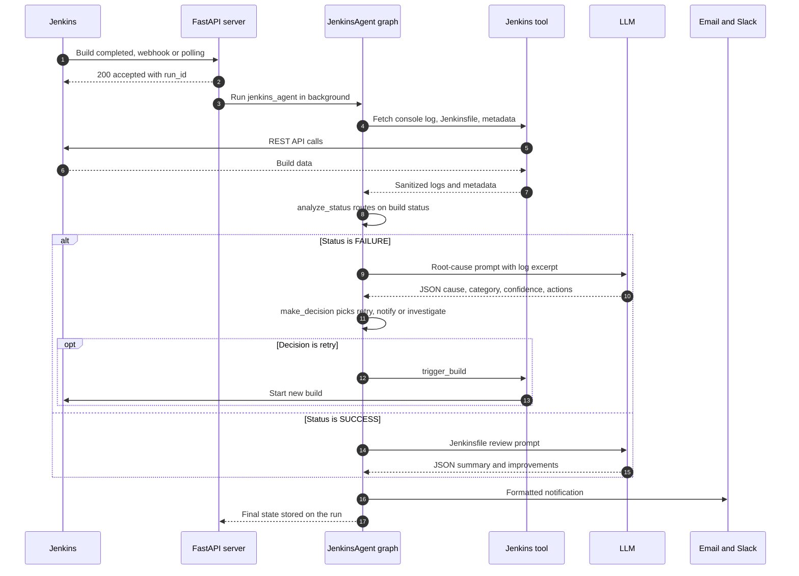

# Jenkins Agent

**An AI agent that watches your Jenkins builds, explains why they failed, retries the ones that look transient, and reports back by email or Slack.**


## Demo

[](https://www.youtube.com/watch?v=38-cWAtA4P0)

*Click the thumbnail to watch the full workflow: a build fails, the agent analyzes it, retriggers it and sends the report.*

---

## Table of Contents

- [Overview](#overview)
- [Key Features](#key-features)
- [Architecture](#architecture)
- [Tech Stack](#tech-stack)
- [Getting Started](#getting-started)
- [Usage](#usage)
- [API Reference](#api-reference)
- [Project Structure](#project-structure)
- [Extending: Adding a New Agent](#extending-adding-a-new-agent)
- [Limitations and Roadmap](#limitations-and-roadmap)
- [Documentation](#documentation)

---

## Overview

When a CI build goes red, someone usually has to open Jenkins, scroll through thousands of console lines, find the real error (often near the end), work out whether it is a flaky network issue or a genuine bug, and then either click "Rebuild" or tell the right people. It is slow, repetitive, and easy to get wrong.

**Jenkins Agent automates that loop.** For every completed build it:

1. **Collects context** from Jenkins: the console log, the build metadata, and the pipeline's `Jenkinsfile`.
2. **Sanitizes the logs** by masking secrets, tokens, IPs, emails and other sensitive data before anything reaches an LLM.
3. **Routes on the build status:**
   - **FAILURE**: an LLM reads the logs and returns a structured root-cause analysis (cause, category, confidence, suggested actions). A decision step then chooses to **retry**, **notify**, or **flag for investigation**, and retriggers the job through the Jenkins API when a retry makes sense.
   - **SUCCESS**: the LLM reviews the `Jenkinsfile` and suggests concrete improvements (timeouts, caching, parallel stages, credential handling, and so on).
   - **Anything else** (UNSTABLE, ABORTED, NOT_BUILT, ...): a plain status notification.
4. **Notifies the team** by email (SMTP) and/or Slack with the analysis and the action taken.

Builds reach the agent through a **Jenkins webhook**, a built-in **polling service** that detects new builds automatically, or the **CLI** for one-off runs. A small **web dashboard** shows recent runs and their AI analysis.

### Built on a small multi-agent framework

The Jenkins agent is the flagship of a lightweight framework (the `ai_agents` package) for building **YAML-defined LangGraph agents**. Each agent is a folder with a `config.yaml` (state schema, nodes, edges), a `handlers.py` (one Python function per node) and optional prompt templates. Agents are registered in a central registry and share the same CLI, REST API, tool registry and memory backends. Two smaller example agents ship alongside it: `calculator` (offline, no LLM) and `sales_assistant`.

---

## Key Features

| Feature | Details |
|---|---|
| **LLM root-cause analysis** | Failure logs (head and tail kept when long) are sent with a structured prompt; the model returns JSON with `cause`, `category` (`network`, `dependency`, `syntax`, `configuration`, `resource`, `permission`, `unknown`), `confidence` and `suggested_actions`. |
| **Automatic retry decisions** | Rule-based decision layer on top of the LLM analysis: high-confidence network/resource failures or retry keywords lead to a retrigger via the Jenkins API; code and config errors lead to a high-urgency notification; low-confidence analyses are flagged for investigation. |
| **Jenkinsfile review on success** | Green builds are not ignored: the pipeline definition is reviewed for best practices, performance, security and maintainability. |
| **Log sanitization** | Regex-based masking of passwords, API keys, Jenkins tokens, AWS keys, private keys, JWTs, DB URLs, IPs, emails, phone numbers and more. Optional deeper PII detection with Microsoft Presidio. |
| **Three ways to trigger** | Jenkins webhook endpoint, background polling of all jobs, or CLI with a JSON input file. |
| **Notifications** | Email via SMTP and Slack Incoming Webhooks, both optional. |
| **REST API and dashboard** | FastAPI server to list, run and inspect agents, with Swagger docs and a static monitoring dashboard. |
| **Declarative workflows** | The agent graph lives in YAML and can be rendered to a PNG with Graphviz. |

### Dashboard


<details>
<summary>Failure analysis detail view</summary>


</details>

---

## Architecture

### System overview



### Agent workflow (LangGraph)

The graph is built by `WorkflowAgent._build_workflow_graph()` from [`src/ai_agents/agents/jenkins_agent/config.yaml`](src/ai_agents/agents/jenkins_agent/config.yaml). All edges are static except the conditional edge out of `analyze_status`, which routes on the `next_node` value set by its handler.



| Node | Responsibility |
|---|---|
| `receive_webhook` | Accepts the payload from `webhook_data`, `input`, or the raw state (CLI). |
| `extract_job_data` | Resolves job, build number and credentials, then fetches console log, `Jenkinsfile` (inline pipeline script or GitHub raw file for SCM pipelines), build metadata and node info. Sanitizes the logs and retries once if they are empty. |
| `analyze_status` | Routes to the success, failure or other-status branch. |
| `handle_failure` | Sends sanitized logs to the LLM with [`handle_failure.tpl`](src/ai_agents/agents/jenkins_agent/prompts/handle_failure.tpl) and parses the JSON analysis. |
| `make_decision` | Chooses `retry`, `notify` or `investigate` from category, confidence and retry keywords; at most 2 retries per run. |
| `execute_action` | Retriggers the job through the Jenkins API when the decision is `retry`. |
| `handle_success` | Sends the `Jenkinsfile` to the LLM with [`handle_success.tpl`](src/ai_agents/agents/jenkins_agent/prompts/handle_success.tpl) and stores improvement suggestions. |
| `suggest_improvements` | Passes the improvements on to formatting. |
| `handle_other_status` | Builds a simple status notification. |
| `format_notification` | Renders [`format_notification.tpl`](src/ai_agents/agents/jenkins_agent/prompts/format_notification.tpl) with the analysis and action taken. |
| `send_notifications` | Sends email and/or Slack depending on configuration. |
| `end_process` / `handle_error` | Terminal nodes. |

### Request lifecycle: a failed build



---

## Tech Stack

| Layer | Technology |
|---|---|
| Language | Python 3.9+ (Docker image uses 3.11) |
| Agent orchestration | [LangGraph](https://github.com/langchain-ai/langgraph) `StateGraph`, YAML-defined workflows |
| LLM access | OpenAI Python SDK against an OpenAI-compatible endpoint (OpenRouter by default); LangChain `ChatOpenAI` for framework-level models |
| Jenkins integration | `python-jenkins` and the Jenkins REST API via `requests` |
| API server | FastAPI, Uvicorn, Pydantic Settings |
| Notifications | SMTP (`smtplib`), Slack Incoming Webhooks |
| Memory backends (optional) | Redis, local vector store |
| Tooling | Poetry, Graphviz (workflow rendering), pre-commit, flake8, black, pytest |
| Deployment | Dockerfile |

---

## Getting Started

### Prerequisites

- **Python 3.9+** and **[Poetry](https://python-poetry.org/)**
- A **Jenkins** instance reachable from where the agent runs, plus a user with an **API token** (Jenkins: *your user* > *Configure* > *API Token*). The user needs read access to jobs and, for automatic retries, permission to build.
- An **LLM API key** for an OpenAI-compatible provider. The handlers call `openai/gpt-3.5-turbo` through **OpenRouter** by default.
- *(Optional)* SMTP credentials (for example a Gmail app password) and/or a Slack Incoming Webhook URL.
- *(Optional)* Graphviz system binaries, to render workflow diagrams.

### Installation

```bash
git clone https://github.com/yessineabdelmaksoud/jenkins-agent.git
cd jenkins-agent

pip install poetry
poetry install          # use `poetry install --no-root` if installing the root package fails
```

### Configuration

Copy the example file and fill in your values:

```bash
cp .env.example .env
```

| Variable | Required | Default | Description |
|---|---|---|---|
| `OPENAI_API_KEY` | Yes | | LLM API key. The CLI refuses to start without it; the handlers use it first. |
| `OPENROUTER_API_KEY` | No | | Used by the handlers when `OPENAI_API_KEY` is not set. |
| `OPENAI_API_BASE` | No | | Overrides the LLM base URL. |
| `OPENROUTER_BASE_URL` | No | `https://openrouter.ai/api/v1` | LLM base URL when `OPENAI_API_BASE` is not set. |
| `JENKINS_URL` | Yes | | Base URL of your Jenkins server. |
| `JENKINS_USER` | Yes* | | Jenkins username (*required unless anonymous read is enabled). |
| `JENKINS_TOKEN` | Yes* | | Jenkins API token. |
| `JENKINS_SANITIZE_LOGS` | No | `true` | Mask sensitive data in logs before analysis. |
| `JENKINS_ENABLE_ADVANCED_PII` | No | `false` | Enable Presidio PII detection (requires `presidio-analyzer`, not installed by default). |
| `JENKINS_POLLING_ENABLED` | No | `true` | Start the polling service with the API server. |
| `JENKINS_POLLING_INTERVAL` | No | `5` | Seconds between polling cycles. |
| `EMAIL_SENDER` | No | | SMTP username / sender address. Email is skipped if unset. |
| `EMAIL_PASSWORD` | No | | SMTP password or app password. |
| `EMAIL_TO` | No | | Notification recipient(s). |
| `SMTP_HOST` | No | `smtp.gmail.com` | SMTP server. |
| `SMTP_PORT` | No | `587` | SMTP port. |
| `SLACK_WEBHOOK_URL` | No | | Slack Incoming Webhook. Slack is skipped if unset. |
| `HOST` / `PORT` | No | `0.0.0.0` / `8000` | API server bind address. |
| `DEBUG` | No | `false` | Enables Uvicorn auto-reload. |
| `LOG_LEVEL` | No | `INFO` | API server log level. |
| `MAX_EXECUTION_TIME` | No | `300` | Per-run timeout (seconds) for `POST /api/agents/{id}/run`. |

> Never commit your `.env` file. It is listed in `.gitignore`.

### Running

**Option 1: API server (recommended).** Starts the REST API, the dashboard and, unless disabled, the Jenkins polling service.

```bash
python src/ai_agents/deployment/api_agent/start_api.py
```

- Swagger UI: http://localhost:8000/docs
- ReDoc: http://localhost:8000/redoc
- Dashboard: http://localhost:8000/dashboard
- Health check: http://localhost:8000/health

**Option 2: CLI, one build at a time.** Edit [`input.json`](input.json) with your job and build number, then:

```bash
python run_cli.py jenkins_agent --input-file input.json
```

**Option 3: minimal webhook server.** A single `POST /webhook` endpoint, without the dashboard or polling:

```bash
PYTHONPATH=src python -m ai_agents.agents.jenkins_agent.server
```

### Connecting Jenkins

Pick one:

- **Polling (zero Jenkins config):** leave `JENKINS_POLLING_ENABLED=true`. The service lists all jobs, detects new `lastBuild` numbers, waits for each build to finish and forwards it to the webhook endpoint.
- **Webhook:** configure Jenkins to POST build notifications to `http://<agent-host>:8000/api/jenkins/webhook`. The endpoint only processes payloads with `build.phase == "COMPLETED"` and a non-empty `build.status`; others are acknowledged and skipped.

### Docker

The Dockerfile expects the repository root as build context and copies your `.env` into the image:

```bash
docker build -f src/ai_agents/deployment/api_agent/Dockerfile -t jenkins-agent .
docker run -p 8000:8000 jenkins-agent
```

> **Note:** the image bakes `.env` in, so do not push it to a public registry. The Dockerfile uses `poetry install --no-dev`, which recent Poetry releases no longer accept; you may need `--only main --no-root` instead.

### Tests and quality checks

```bash
# API unit tests (agent service mocked)
pytest src/ai_agents/deployment/api_agent/tests/test_api.py

# Check that settings load correctly
python src/ai_agents/deployment/api_agent/test_config.py

# End-to-end smoke test: needs a reachable Jenkins and an LLM key
python test_jenkins_agent.py

# Lint and formatting hooks (also run on GitLab merge requests via .gitlab-ci.yml)
pre-commit run --all-files
```

---

## Usage

### Analyze a specific build from the CLI

```json
{
  "job_name": "my-pipeline",
  "build_number": 42,
  "jenkins_url": "http://localhost:8080",
  "build_status": "FAILURE"
}
```

```bash
python run_cli.py jenkins_agent --input-file input.json
# or inline
python run_cli.py jenkins_agent --input '{"job_name": "my-pipeline", "build_number": 42}'
```

The final graph state is printed, including `failure_analysis`, `decision`, `action_taken` and `notification_results`.

### Simulate a Jenkins webhook

```bash
curl -X POST http://localhost:8000/api/jenkins/webhook \
  -H "Content-Type: application/json" \
  -d '{
        "name": "my-pipeline",
        "build": { "number": 42, "phase": "COMPLETED", "status": "FAILURE" }
      }'
```

`job_name` and `build_number` are derived from `name` and `build.number`; `jenkins_url` falls back to `JENKINS_URL`. The response contains a `run_id` you can poll:

```bash
curl http://localhost:8000/api/agents/jenkins_agent/runs/<run_id>
```

### Example failure analysis

The LLM is asked to return exactly this shape (from [`handle_failure.tpl`](src/ai_agents/agents/jenkins_agent/prompts/handle_failure.tpl)):

```json
{
  "cause": "Brief description of the root cause",
  "suggested_actions": ["Action 1", "Action 2", "Action 3"],
  "confidence": 0.85,
  "category": "network|dependency|syntax|configuration|resource|permission|unknown"
}
```

### Render the workflow graph

```bash
python src/ai_agents/workflows/visualizer/render_graph.py src/ai_agents/agents/jenkins_agent/config.yaml
```

This writes `workflow_graph.png` to the current directory (requires Graphviz).

---

## API Reference

All routes below are served by `start_api.py`. Interactive docs are at `/docs`.

| Method | Path | Description |
|---|---|---|
| `GET` | `/` | API info |
| `GET` | `/health` | Health check |
| `GET` | `/dashboard` | Monitoring dashboard (static HTML) |
| `GET` | `/api/agents` | List registered agents |
| `GET` | `/api/agents/{agent_id}` | Agent details and configuration |
| `GET` | `/api/agents/{agent_id}/config` | Agent workflow configuration |
| `POST` | `/api/agents/{agent_id}/run` | Run an agent. Body: `{"input_data": {...}, "config_override": null, "timeout": null}` |
| `GET` | `/api/agents/{agent_id}/status` | Status of the current or latest run |
| `GET` | `/api/agents/{agent_id}/runs` | List runs |
| `GET` | `/api/agents/{agent_id}/runs/{run_id}` | Run details, result and logs |
| `DELETE` | `/api/agents/{agent_id}/runs/{run_id}` | Cancel a run |
| `POST` | `/api/jenkins/webhook` | Jenkins build webhook, triggers `jenkins_agent` in the background |
| `GET` | `/api/jenkins/polling/status` | Polling service status |
| `POST` | `/api/jenkins/polling/start` | Start polling |
| `POST` | `/api/jenkins/polling/stop` | Stop polling |

The minimal server in `jenkins_agent/server.py` exposes only `POST /webhook`.

---

## Project Structure

```text
jenkins-agent/
├── run_cli.py                      # CLI launcher (no PYTHONPATH needed)
├── input.json                      # Sample CLI input
├── test_jenkins_agent.py           # End-to-end smoke test
├── pyproject.toml / poetry.lock
├── .env.example
├── docs/                           # Jenkins agent guide, deployment guide, screenshots
└── src/ai_agents/
    ├── agents/
    │   ├── agent_base.py           # Abstract agent interface
    │   ├── workflow_agent.py       # YAML -> LangGraph StateGraph builder
    │   ├── registry.py             # Agent name -> class registry
    │   ├── jenkins_agent/          # config.yaml, handlers.py, prompts/, server.py
    │   ├── calculator/             # Offline example agent
    │   └── sales_assistant/        # Example LLM agent
    ├── tools/
    │   ├── tool_registry.py        # Global tool registry
    │   ├── jenkins_wrapper.py      # "jenkins" tool
    │   ├── notifications_wrapper.py# "notifications" tool
    │   ├── jenkins/                # REST client, data extractor, log sanitizer
    │   └── notifications/          # Email and Slack notifiers
    ├── workflows/
    │   ├── core/ utils/            # Handlers, prompts, node types, transitions
    │   └── visualizer/             # Graphviz rendering
    ├── memory/                     # Redis and vector-store backends
    ├── model/loader.py             # LangChain model loader
    ├── execution/                  # CLI, runner, batch
    └── deployment/api_agent/
        ├── main.py / start_api.py  # FastAPI app and launcher
        ├── api/                    # Routes and Pydantic models
        ├── services/               # AgentService, JenkinsPollingService
        ├── dashboard/              # HTML/CSS/JS dashboard
        ├── tests/test_api.py
        └── Dockerfile
```

---

## Extending: Adding a New Agent

Every agent follows the same pattern as `jenkins_agent` and `calculator`:

1. **Create a folder** `src/ai_agents/agents/my_agent/` with:
   - `config.yaml`: `state_schema`, plus `workflow.entrypoint`, `workflow.nodes` (name, handler, type) and `workflow.edges` (from, to).
   - `handlers.py`: one function per handler name, with the signature `handler(state, model=None, tools=None, memory=None, node_type=None, **kwargs)` returning the updated state dict.
   - `prompts/<handler_name>.tpl` *(optional)*: a `string.Template` prompt rendered with the state. You can also define `<handler_name>_prompt(state, prompt_template)` in `handlers.py` to build the prompt yourself.
2. **Create the agent class** in `__init__.py` by subclassing `WorkflowAgent` and setting `default_config_path`, `handler_module` and `prompt_dir` (copy `calculator/__init__.py`).
3. **Register it** in [`src/ai_agents/agents/registry.py`](src/ai_agents/agents/registry.py):

   ```python
   AGENT_REGISTRY = {
       ...,
       "my_agent": MyAgent,
   }
   ```

4. **Run it** with `python run_cli.py my_agent --input '{"key": "value"}'` or `POST /api/agents/my_agent/run`.

Tools are added by subclassing `BaseTool` (`name`, `description`, `run`) and registering the class in `src/ai_agents/tools/__init__.py`; handlers then fetch them with `ToolRegistry.get_tool("<name>")`.

> Conditional edges are currently wired in `WorkflowAgent._build_workflow_graph()` with a fixed set of Jenkins targets. A new agent that needs branching should extend that mapping.

---

## Limitations and Roadmap

**Current limitations**

- **Model is hardcoded.** The Jenkins handlers call `openai/gpt-3.5-turbo` (OpenRouter naming) via the OpenAI SDK; they do not use the `model:` block from `config.yaml`. Pointing `OPENAI_API_BASE` at api.openai.com requires changing the model id.
- **Retry cap is per run.** `retry_count` lives in the graph state, so the 2-retry limit does not carry over to the new build that a retry triggers.
- **Error routing.** Only `analyze_status` has a conditional edge; when another node sets `next_node = "handle_error"`, the static edge still runs the next node.
- **In-memory run history.** API run records and polling state are lost on restart and are not shared between workers.
- **Jenkinsfile fetch** for SCM pipelines only supports public GitHub repositories (raw URL); other providers fall back to an empty `Jenkinsfile`.
- **No authentication** on the API or webhook endpoint, and CORS allows all origins by default. Put it behind a reverse proxy or private network.

**Roadmap ideas**

- Make the LLM provider and model configurable per agent.
- Persist run history and retry counters (Redis is already a dependency).
- Webhook signature verification and API authentication.
- Generic, config-driven conditional edges for all agents.
- Broader test coverage for the agent handlers.

---

## Documentation

- [Jenkins Agent Guide](docs/JENKINS_AGENT.md): workflow details, configuration and troubleshooting
- [Deployment Guide](docs/DEPLOYMENT.md): API, Docker and Kubernetes notes
- [How to Add a New Agent](docs/how_to_add_agent.md)
- [Dashboard README](src/ai_agents/deployment/api_agent/dashboard/README.md)
- [API agent README](src/ai_agents/deployment/api_agent/README.md)

---

Built by [Yessine Abdelmaksoud](https://github.com/yessineabdelmaksoud) · [Portfolio](https://yessineabdelmaksoud.github.io)
